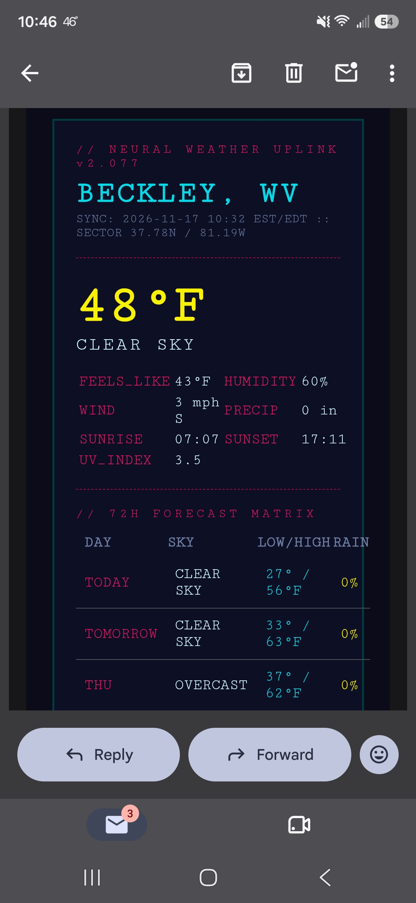

# BECKLEY Cyberpunk Weather Briefing ⚡

> **n8n Workflow ID:** `JU7rdhnHuS3cFTpq`  
> **Status:** Published and Active  
> **Development Style:** AI-assisted / "Vibe Coded" low-code automation

---

## 🌟 What It Does
This automated pipeline wakes up every morning to fetch, style, and deliver a high-impact weather briefing straight to your inbox.

* **Schedule Trigger:** Runs every day at **7:00 AM** (configured under the assumption of New York time; subject to n8n instance timezone settings).
* **Data Fetcher:** Pulls current conditions and a 3-day weather forecast for **Beckley, WV** directly from the **Open-Meteo API** (requires no API key).
* **HTML Formatter:** Transforms the raw meteorological data into a custom, **neon-styled cyberpunk HTML email**.
* **Delivery:** Sends the styled briefing through Gmail to `jknotitia@gmail.com` (an assumption derived from project context).

---

## 🛡️ Error Handling & Resilience
While built using low-code/AI-assisted methods, the pipeline includes built-in safeguards to maintain reliability:

* **Automatic Retries:** 
  * Weather data fetching retries up to **4 times** upon failure.
  * Email dispatch retries up to **3 times** if connection hiccups occur.
* **Data Validation:** The formatter node is configured to throw an explicit error if any vital weather data fields are missing or incomplete.
* **Failure Alerts:** If the fetch, format, or send sequence completely exhausts its retries, a dedicated error handler triggers an alert email containing the exact error message and execution ID.

---

## 🧪 Testing Status & Reality Check
*In the spirit of honest development, here is what has actually been verified:*

* ✅ **Tested & Working:** One live manual execution successfully fetched real-time weather data, compiled the HTML structure, and dispatched the email. Delivery was confirmed, though the layout formatting in the inbox still needs a visual check.
* ❌ **Not Tested (Yet):** 
  * **Failure Alert Path:** The error-handling alert email has never been triggered or tested in live conditions.
  * **Gmail Dependency:** If Gmail itself goes down or experiences authentication failure, the alert system cannot send notifications either.
  * **Scheduled Trigger:** The 7:00 AM daily cron schedule has not fired autonomously yet (the first scheduled run is set for tomorrow).
  * **Timezone Offset:** The schedule assumes local New York time; if the hosting n8n container/instance uses UTC or another timezone, execution hours may need adjustment.

---

## ⚠️ Known Limits
* **"Self-Healing" Boundaries:** The workflow's resilience relies entirely on **configured retries plus failure alerts**. 
* **No Failover Source:** It does not dynamically switch to an alternative backup weather provider or patch its own code if the Open-Meteo API structure changes.

---

## 🚀 How to Use / Import
If you want to inspect or import this workflow into your own n8n instance:
1. Copy the Workflow ID: `JU7rdhnHuS3cFTpq`
2. Import via your n8n dashboard or API.
3. Verify your Gmail credential node connection and update the recipient email address if needed.
